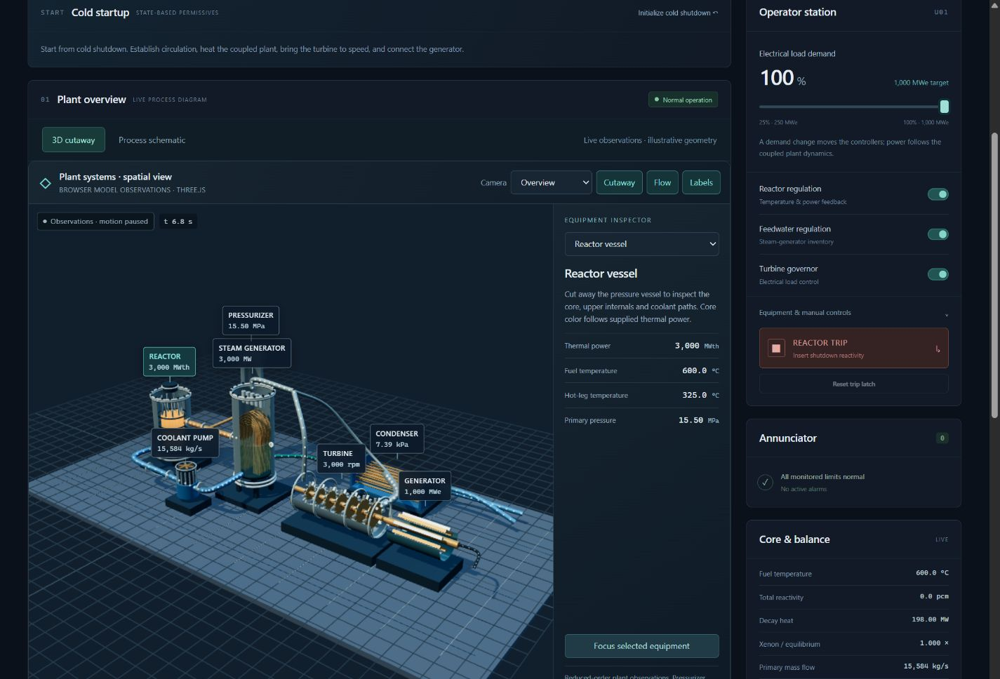

# OpenPWR

**A transparent 1,000 MWe PWR simulation laboratory.** An interactive control room and a deterministic engineering model, with inspectable equations, reproducible scenarios, and numerical evidence.

[Launch control room](https://ajayasai.github.io/OpenPWR/) · [Benchmark & verification evidence](https://ajayasai.github.io/OpenPWR/verification.html) · [Model equations](docs/MODEL.md) · [Validation scope](docs/VALIDATION.md)

**New in v0.7:** a finite auxiliary-feedwater tank and two native pump trains, with automatic actuation, manual controls, availability and valve faults, conservation checks, and animated equipment. The experimental pressurizer gains temperature-dependent steel properties, resolved wall surfaces and four wall meshes. The [evidence page](https://ajayasai.github.io/OpenPWR/plant-evidence.html) adds a reserved PACTEL ATWS-11 compression comparison scored only after the candidate source freeze. It preserves raw discrepancies and prior releases' baselines. The interactive plant retains its equilibrium pressurizer; the experimental pressure model is used by the reference cases. This is progress toward full scope; it is not a validated full-scope simulator.

The optional [OpenModelica engineering workbench](docs/ENGINEERING.md) runs compiled models through FMI and FMPy. Its [coupled hot plant](docs/NATIVE_PLANT.md) and isolated [primary-loop workbench](docs/MODELICA_MODEL.md) are distinct experiments. The browser whole-plant model below remains available, including its generic cold-start experiment. Native cold startup is not yet implemented.

OpenPWR's browser edition models a generic pressurized-water plant at system level. Reactor power emerges from neutron kinetics and feedback, while the coolant, steam system, turbine, condenser, and controllers respond together. Its UI and command-line runner use the **same JavaScript engine**.



## What is included

- Six delayed-neutron groups, temperature reactivity feedback, iodine/xenon dynamics, and decay heat.
- Fuel, primary coolant, and steam-generator thermal storage; steam/feedwater inventory; water saturation properties; a turbine/generator and condenser model.
- Automatic load, feedwater, and turbine controls, with manual overrides and a latched reactor trip.
- Cold initialization, source-driven subcritical kinetics, heatup, hot thermal hold, turbine acceleration, and conditional grid connection. Temperatures and stored inventories evolve through the same engine.
- Pump-trip, feedwater-loss, turbine-trip, and heat-sink-loss experiments.
- Animated process diagram with visible flow, pump/rotor motion, steam generation, and generator power direction, including a scrollable mobile view. Motion follows model observations, freezes with pause, and respects reduced-motion preferences.
- Interactive 3D cutaway, orbit/zoom and camera presets, selectable equipment with actual model readings, keyboard/touch controls, and a process-schematic alternative. Geometry is illustrative and does not add physics. The renderer is vendored locally under MIT; no CDN is required.
- Unit-labeled trends, alarms/events, adjustable simulation speed, JSON snapshots, and CSV export.
- A headless runner, published point-kinetics and water-property benchmark comparisons, machine-readable evidence, and CI on Linux and Windows.

## Scope and accuracy

This is a **reduced-order engineering model**, not a validated replica of an operating facility. The browser edition covers cold initialization through generic startup to hot power operation and selected transients. The nominal point is 3,000 MW thermal and 1,000 MW net electrical; nominal calibration is an assumption, not validation data.

The browser startup sequence is an educational, reactor-assisted heatup experiment with generic controls and permissives. It is not a named plant's startup procedure. A resolved pressurizer, multi-loop hydraulics, spatial core physics, complete water/steam property regions, emergency core cooling, containment, fuel damage, severe-accident chemistry, and plant-specific instrumentation remain outside the browser model. The native coupled plant adds an equilibrium pressurizer and native secondary/electrical balances within a hot-system envelope. It still omits native cold startup, multiple loops, spatial core physics, detailed turbine/feed heaters, containment, and emergency cooling. Each engine stops at its declared boundaries. Read [MODEL.md](docs/MODEL.md) and [NATIVE_PLANT.md](docs/NATIVE_PLANT.md) before interpreting results.

Tests establish numerical consistency, agreement with cited published component benchmarks, and expected generic responses. The [Krško comparison](docs/MEASURED_VALIDATION.md) uses measured boundary inputs and holds out pressure and temperature channels; missing plant configuration and instrument uncertainty prevent a validation pass. These results do not qualify the program for plant operation, safety analysis, or operator licensing. [Benchmark provenance](docs/BENCHMARKS.md) and [the development roadmap](docs/ROADMAP.md) distinguish implemented models from demonstrated fidelity.

## Run locally

Install [Node.js](https://nodejs.org/) 22 or newer, then:

```sh
git clone https://github.com/ajayasai/OpenPWR.git
cd OpenPWR
npm test
npm run verify
npm run build
npm start
```

Open `http://127.0.0.1:4173`. There are **no npm dependencies to install**. For development, `npm run dev` serves the source directly. The `dist/` directory is a portable static site; any HTTP server can host it. Native ES modules require HTTP, so opening `index.html` directly as a file is not supported.

## Reproducible experiments

For the native coupled plant, install the open-source tools in [ENGINEERING.md](docs/ENGINEERING.md), then run:

```sh
npm run engineering:setup
npm run engineering:build
npm run engineering:test
npm run engineering:plant:verify
npm run engineering:measured -- --build
npm run engineering:pressurizer -- --build
npm run engineering:plant:start
```

Open `http://127.0.0.1:8002/plant.html`. Native experiments include load reduction, reactor/turbine trips, main and auxiliary feedwater, cooling and pump changes, with reproducible command replay. GitHub Pages shows the interface and saved evidence; the native solver runs locally. Read [auxiliary-feedwater equations and limits](docs/AUXILIARY_FEEDWATER.md) before interpreting its generic actuation logic.

The browser-only model has its own independent experiments:

```sh
npm run simulate -- --scenario=load-step --duration=600 --output=artifacts/load-step.csv
npm run simulate -- --scenario=scram --duration=90 --output=artifacts/scram.csv
npm run simulate -- --scenario=cold-start --duration=36000 --output=artifacts/cold-start.csv
npm run benchmark
npm run simulate -- --help
```

Hot-scenario events occur at simulation time 60 seconds. The cold-start director checks the engine's permissives each simulated second and applies ordinary control actions; after connection it raises net demand by 10 MWe per simulated minute. The runner writes a CSV plus JSON metadata, action timestamps, and final state. A model-domain exit returns status 2 rather than continuing extrapolation. The browser exports snapshots that preserve all internal dynamics for continuation; CSV histories are bounded to the visible session buffer.

## Architecture

```text
Browser controls → model API → deterministic engine → observations / plots
                                  ↑
                            headless runner
                                  ↑
                       independent tests / evidence
```

`src/physics.js` contains numerical/property helpers. `src/engine.js` couples states, controls, and protection. `src/app.js` renders the control room. `src/scenarios.js` supplies reproducible inputs through the public model API. `tests/` contains verification; `scripts/verify.mjs` and `scripts/benchmark.mjs` produce the release's public evidence reports. `npm run verify` runs both reports; builds reject failed evidence or evidence from a different version/commit.

## Fully open stack

Original source and documentation: **Apache-2.0**. The browser physics engine has no runtime package dependencies; its 3D view uses locally vendored **Three.js under MIT**. Optional engineering mode uses OpenModelica, the Modelica Standard Library, FMPy and their open-source dependencies, under their respective licenses. It requires a local native solver service. Neither edition requires a proprietary solver, private plant dataset, telemetry, API key, cloud computation, or remote font. GitHub Pages is optional static hosting and cannot execute the native FMU; GitHub Actions is optional CI. Source availability does not imply physical-model completeness.

See [LICENSE](LICENSE), [NOTICE](NOTICE), and [dependency inventory](docs/OPEN_SOURCE.md).

## Contributing

Start with [CONTRIBUTING.md](CONTRIBUTING.md). Useful contributions include independently sourced reference cases, uncertainty studies, richer thermodynamics, and accessible interface improvements. Each new model should document its equations, units, parameter provenance, domain, and verification evidence. Improvements to fidelity take priority over adding unverified gauges.
