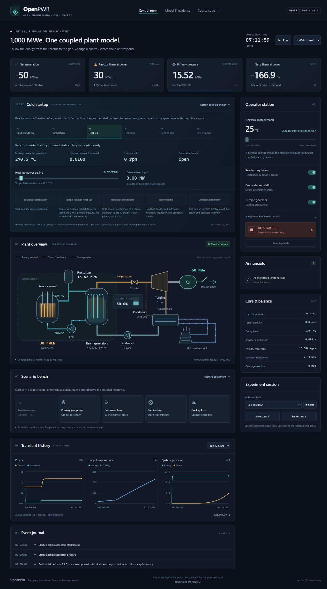

# OpenPWR

**A transparent 1,000 MWe PWR simulation laboratory.** An interactive control room and a deterministic engineering model, with inspectable equations, reproducible scenarios, and numerical evidence.

[Launch control room](https://ajayasai.github.io/OpenPWR/) · [Benchmark & verification evidence](https://ajayasai.github.io/OpenPWR/verification.html) · [Model equations](docs/MODEL.md) · [Validation scope](docs/VALIDATION.md)

OpenPWR models a generic pressurized-water plant at system level. Reactor power emerges from neutron kinetics and feedback, while the coolant, steam system, turbine, condenser, and controllers respond together. The UI and command-line runner use the **same engine**.



## What is included

- Six delayed-neutron groups, temperature reactivity feedback, iodine/xenon dynamics, and decay heat.
- Fuel, primary coolant, and steam-generator thermal storage; steam/feedwater inventory; water saturation properties; a turbine/generator and condenser model.
- Automatic load, feedwater, and turbine controls, with manual overrides and a latched reactor trip.
- Cold initialization, source-driven subcritical kinetics, heatup, hot thermal hold, turbine acceleration, and conditional grid connection. Temperatures and stored inventories evolve through the same engine.
- Pump-trip, feedwater-loss, turbine-trip, and heat-sink-loss experiments.
- Animated process diagram with visible flow, pump/rotor motion, steam generation, and generator power direction, including a scrollable mobile view. Motion follows model observations, freezes with pause, and respects reduced-motion preferences.
- Unit-labeled trends, alarms/events, adjustable simulation speed, JSON snapshots, and CSV export.
- A headless runner, published point-kinetics and water-property benchmark comparisons, machine-readable evidence, and CI on Linux and Windows.

## Scope and accuracy

This is a **reduced-order engineering model**, not a validated replica of an operating facility. Version 0.2 extends the operating envelope from cold initialization through generic startup to hot power operation and selected transients. The nominal point is 3,000 MW thermal and 1,000 MW net electrical; nominal calibration is an assumption, not validation data.

The startup sequence is an educational, reactor-assisted heatup experiment with generic controls and permissives. It is not a named plant's startup procedure. A resolved pressurizer, multi-loop hydraulics, spatial core physics, complete water/steam property regions, emergency core cooling, containment, fuel damage, severe-accident chemistry, and plant-specific instrumentation remain outside the model. The engine stops at declared model-domain boundaries. Read [MODEL.md](docs/MODEL.md) before interpreting results.

Tests establish numerical consistency, agreement with cited published component benchmarks, and expected generic responses. They do not establish real-plant predictive accuracy or qualify the program for plant operation, safety analysis, or operator licensing. [Benchmark provenance](docs/BENCHMARKS.md) records inputs, references, and tolerances. [The development roadmap](docs/ROADMAP.md) distinguishes remaining model work from the evidence needed for full-scope claims.

## Run locally

Install [Node.js](https://nodejs.org/) 22 or newer, then:

```sh
git clone https://github.com/ajayasai/OpenPWR.git
cd OpenPWR
npm test
npm run verify
npm run build
npm start
```

Open `http://127.0.0.1:4173`. There are **no npm dependencies to install**. For development, `npm run dev` serves the source directly. The `dist/` directory is a portable static site; any HTTP server can host it. Native ES modules require HTTP, so opening `index.html` directly as a file is not supported.

## Reproducible experiments

```sh
npm run simulate -- --scenario=load-step --duration=600 --output=artifacts/load-step.csv
npm run simulate -- --scenario=scram --duration=90 --output=artifacts/scram.csv
npm run simulate -- --scenario=cold-start --duration=36000 --output=artifacts/cold-start.csv
npm run benchmark
npm run simulate -- --help
```

Hot-scenario events occur at simulation time 60 seconds. The cold-start director checks the engine's permissives each simulated second and applies ordinary control actions; after connection it raises net demand by 10 MWe per simulated minute. The runner writes a CSV plus JSON metadata, action timestamps, and final state. A model-domain exit returns status 2 rather than continuing extrapolation. The browser exports snapshots that preserve all internal dynamics for continuation; CSV histories are bounded to the visible session buffer.

## Architecture

```text
Browser controls → model API → deterministic engine → observations / plots
                                  ↑
                            headless runner
                                  ↑
                       independent tests / evidence
```

`src/physics.js` contains numerical/property helpers. `src/engine.js` couples states, controls, and protection. `src/app.js` renders the control room. `src/scenarios.js` supplies reproducible inputs through the public model API. `tests/` contains verification; `scripts/verify.mjs` and `scripts/benchmark.mjs` produce the release's public evidence reports. `npm run verify` runs both reports; builds reject failed evidence or evidence from a different version/commit.

## Fully open stack

Original source and documentation: **Apache-2.0**. No proprietary solver, licensed plant dataset, telemetry, API key, cloud computation, remote font, or runtime package is required. All computation runs on your device. GitHub Pages is optional hosting, and GitHub Actions is optional CI. Source availability does not imply physical-model completeness.

See [LICENSE](LICENSE), [NOTICE](NOTICE), and [dependency inventory](docs/OPEN_SOURCE.md).

## Contributing

Start with [CONTRIBUTING.md](CONTRIBUTING.md). Useful contributions include independently sourced reference cases, uncertainty studies, richer thermodynamics, and accessible interface improvements. Each new model should document its equations, units, parameter provenance, domain, and verification evidence. Improvements to fidelity take priority over adding unverified gauges.
