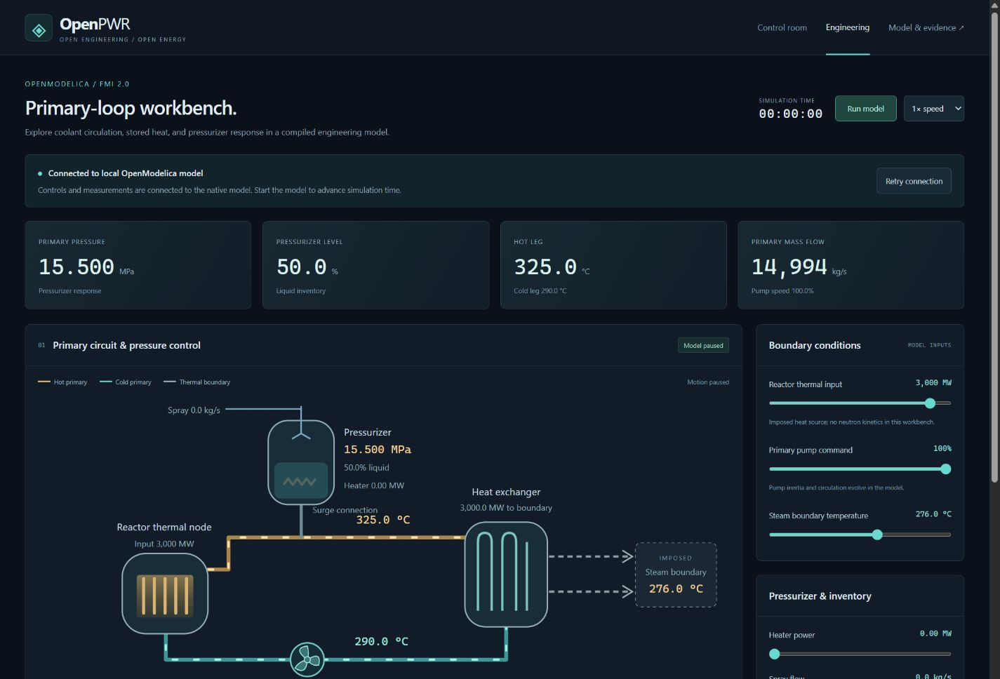

# OpenModelica engineering workbench

The optional engineering workbench executes compiled **OpenModelica FMI 2.0 co-simulation models**, hosted locally by FMPy. Choose the native coupled hot plant or the isolated primary-loop/pressurizer subsystem. The existing JavaScript whole-plant laboratory remains a separate browser-only edition; readings are never silently blended between engines.

The coupled model adds six-group reactor kinetics and decay heat, fuel feedback, steam-generator phase inventories, turbine expansion, rotor energy and generator connection, condenser inventory/cooling, feedwater control and protection. It remains a generic hot-operation model with a deliberately limited domain; native cold startup is not implemented. Its 3D cutaway displays the same observations as the gauges. See [coupled equations and scope](NATIVE_PLANT.md). The isolated primary model retains prescribed reactor heat and secondary temperature boundaries; see [primary equations](MODELICA_MODEL.md).



## Install and run

Install [OpenModelica](https://openmodelica.org/download/) with its Modelica Standard Library and compiler tools, Python 3.10 or newer, and Node.js 22 or newer. `omc` must be on PATH (or set `OPENPWR_OMC` to its executable). Linux instructions: [official minimal compiler installation](https://openmodelica.org/download/download-linux/). On Ubuntu also install `python3-venv`.

From the repository:

```sh
npm run engineering:setup
npm run engineering:build
npm run engineering:test
npm run engineering:verify
npm run engineering:plant:verify
npm run engineering:measured -- --build
npm run engineering:plant:start
```

Open **http://127.0.0.1:8002/plant.html**. For the isolated primary workbench, use `npm run engineering:start` and **http://127.0.0.1:8001/engineering.html**. Both start paused. Run advances the native solver; controls set actual FMI inputs. Pause stops simulation time. Reset creates a nominal initial state. CSV contains native observations; the command log records applied control changes and simulation times. Commands and replay files are validated against the selected model profile.

Setup creates an isolated `artifacts/engineering-venv` and installs `backend/requirements.txt`. No Python libraries are added to the browser edition. The build command compiles `PrimaryLoop.fmu`, `CoupledPlant.fmu`, `KineticsReference.fmu` and `PropertyReferenceChecks.fmu` under `artifacts/modelica`. The measured command separately compiles `KrskoTransient.fmu`. Each has a manifest with source/artifact hashes, compiler, platform and Git revision; build logs remain alongside it. Temporary compilation directories prevent reuse of stale generated files.

### Windows with WSL

The launcher can use a compiler installed inside Ubuntu WSL:

```sh
npm run engineering:setup -- --wsl
```

Subsequent commands reuse that environment. The default distribution is `Ubuntu`; set `OPENPWR_WSL_DISTRO` before setup to choose another. Install the compiler and `python3-venv` in that distribution first. Windows localhost forwarding must be enabled for the browser to reach the WSL service. Native Windows setup is also supported when `omc` and Python are available, but this release's native FMU is tested on Linux/WSL; FMU binaries are platform-specific.

## Architecture and timing

```text
Browser engineering controls
         │ same-origin JSON requests / observations
Loopback Python service + FMPy
         │ FMI 2.0 input, doStep, output calls
OpenModelica PrimaryLoop or CoupledPlant FMU + CVODE
         │
Modelica Standard Library IF97 water properties
```

One FMU owns all states in the selected experiment, including the coupled plant's secondary and electrical systems. The host uses 50 ms communication steps; CVODE integrates internally. Browser display timing never changes the equations. Real-time performance is measured on the target machine, not guaranteed by FMI. Simulated time is explicitly displayed and is authoritative.

The service binds only to `127.0.0.1`. It serves the UI and API from one origin, checks Host and Origin on control requests, bounds inputs and request sizes, and stops advancement on nonfinite outputs, solver errors or the model's declared validity boundary. It is a local single-session service, not an authenticated multiuser cloud deployment.

FMI state serialization is not promised. Use reset plus the recorded commands for reproducible experiments; existing JavaScript save files cannot be loaded into this different model.

## Timed experiments and replay

The coupled plant offers load reduction, reactor trip, turbine trip, feedwater, cooling and pump experiments; the primary workbench offers heater, spray, pump and inventory experiments. Select **Reset & prepare** to validate the schedule and initialize the model; **Run model** advances it. The host applies every event at its exact 50 ms boundary, including when a request spans several events. Completion pauses the UI. Select **Return to manual** to continue from the final state.

**Save command history** records applied controls, times, FMU identity and final observations. **Replay saved commands** validates the entire file before resetting, rejects truncated or different-FMU logs, then replays it using ordinary solver steps. Completion compares the saved and replayed endpoint observations. Histories are bounded; reconnecting restores a sampled view of the native session. All browser tabs share one local session.

The same scheduler runs without the browser:

```sh
npm run engineering:experiment -- --scenario heater --output artifacts/heater
npm run engineering:experiment -- --replay artifacts/heater.commands.json --output artifacts/heater-replay
npm run engineering:plant:experiment -- --scenario load-following --output artifacts/native-load
```

Each run writes a CSV, command history and report; a domain halt or failed comparison returns a nonzero exit status. Inputs remain generic model experiments, not plant operating procedures.

## Evidence

The [primary evidence page](https://ajayasai.github.io/OpenPWR/engineering-evidence.html) and [coupled plant evidence page](https://ajayasai.github.io/OpenPWR/plant-evidence.html) present source/binary identity, traces, check tolerances and measured discrepancies. GitHub deployment requires current successful numerical reports and a completed, current measured comparison. `npm run build -- --require-native --require-plant --require-measured` enforces this locally. Measured disagreement or an inconclusive applicability result is published, not suppressed. Ordinary browser-only builds omit missing or stale native reports.

`npm run engineering:verify` runs the actual compiled FMUs. The primary checks cover nominal equilibrium, analytical pump lag, heater and spray response directions, closed-system mass conservation, external mass accounting, independently integrated boundary energy, communication-step refinement, and deterministic reset/replay. A separate probe makes 24 published comparisons: twelve NISTIR 5078 saturation values and twelve official IAPWS-IF97 compressed-liquid verification values. It also reports 25 numerical derivative-consistency checks separately. The NIST 0.05% tolerance accounts for table precision and IF97/IAPWS-95 differences; exact inputs and tolerances are in the report and model guide.

These are separate from the browser engine's 71 published component comparisons. Coupled checks add independent matrix-exponential kinetics, reactor and turbine trip responses, grid permissives, feedwater/cooling causality, whole-plant mass/energy accounting, refinement and replay. The [measured Krško comparison](MEASURED_VALIDATION.md) separately assesses held-out pressure and temperature traces with measured boundary inputs. Generic geometry and incomplete instrument/configuration information prevent a validation pass.

Reports are `artifacts/modelica-verification.json`, `artifacts/modelica/property-verification.json`, `artifacts/plant-verification.json` and `artifacts/measured-validation.json`. The local workbench checks its evidence FMU hash against the running model. Build guards verify actual FMU bytes, common and benchmark source, CSV and provenance hashes before replacing a deployment. Numerical correctness and real-plant agreement remain distinct claims.

The public GitHub Pages workbench cannot run a native FMU. It presents local launch instructions and disables controls until the local service is available; it does not substitute sample numbers. Native FMUs and their evidence can be distributed as release artifacts with their platform, source revision and compiler identified.

## Open-source provenance

The original model, UI, host and build scripts are Apache-2.0. OpenModelica, the Modelica Standard Library, FMPy and their included runtimes have their own licenses and notices; original code is not a relicensing of those dependencies. This initial integration uses the Modelica Standard Library directly and includes no ThermoSysPro/TRANSFORM code or proprietary solver. See [dependency inventory](OPEN_SOURCE.md).

## Next model increments

Next priorities are independently specified geometry and controller data, additional measured transients with uncertainty, native cold operation/shutdown cooling, multi-loop hydraulics, spatial core response and more detailed secondary equipment. Containment and emergency systems require their own models and evidence. The 3D view must continue to distinguish modeled states from illustrative geometry. See [the roadmap](ROADMAP.md).
